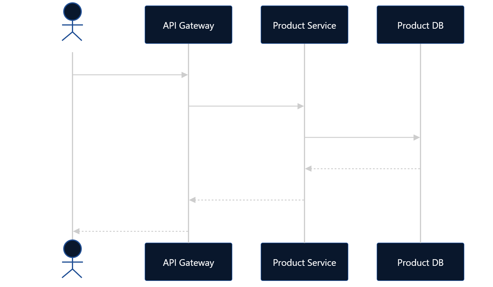
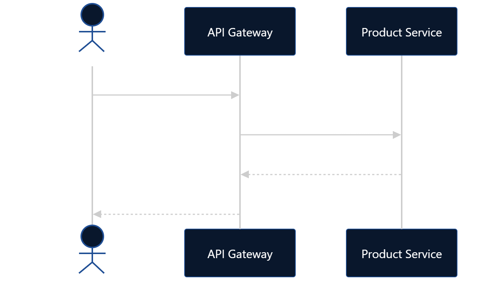
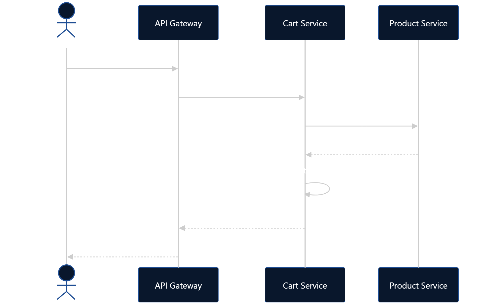
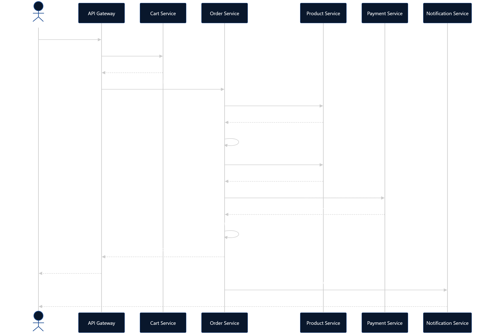
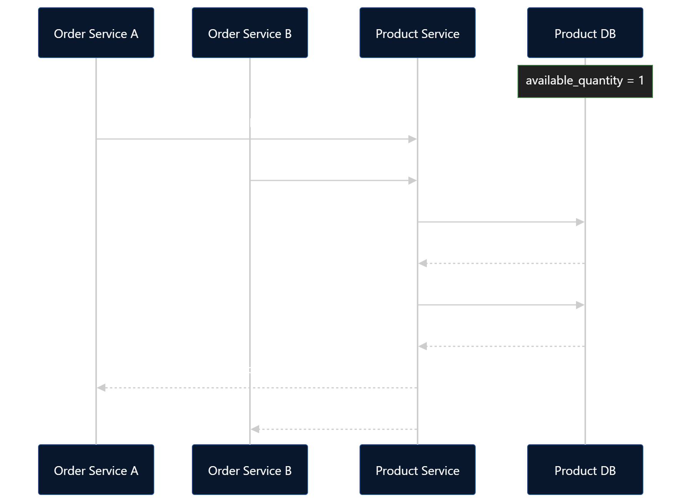

# Scalable E-Commerce Platform

## 1. Problem Statement

Build an e-commerce platform where users can discover products
across different categories, add products to their cart, place
orders, make payments, and receive notifications about their orders.

The system should be designed so that individual business
capabilities can evolve and scale independently.

## 2. Functional Requirements

### User
- Register
- Login
- Authenticate using Google
- Manage profile

### Product
- Browse products
- Search products
- Filter products
- View product details
- View product availability

### Cart
- Add product
- Remove product
- Update quantity
- View cart

### Order
- Place order
- View order
- View order history
- Track order status

### Payment
- Initiate payment
- Handle successful payment
- Handle failed payment
- Check payment status

### Notification
- Send order confirmation
- Send payment notifications
- Send order status notifications

## 3. Non-Functional Requirements

### Scalability
Individual services should be independently scalable.

### Availability
Failure of a non-critical service such as Notification
should not make the entire order fail.

### Reliability
Orders and payments should not be accidentally processed twice.

### Consistency
Inventory must not become negative due to concurrent purchases.

### Security
Authentication and authorization must be enforced.
Sensitive payment information must not be unnecessarily stored.

### Observability
The system should provide logs, metrics and distributed
tracing for diagnosing failures.

### Performance
Product browsing and other read-heavy operations should
remain responsive under high traffic.

## 4. Core User Journeys

### 4.1 Browse Products

1. User opens the product catalog.
2. User searches/filters products.
3. User selects a product.
4. Product details and current availability are displayed.

### 4.2 Add Product to Cart

1. User selects a product.
2. Cart Service receives the request.
3. Product Service verifies that the product exists.
4. Product is added to the user's cart.
5. Inventory is NOT reserved at this stage.

### 4.3 Checkout

1. User initiates checkout.
2. Order Service obtains the current product information
   and prices from Product Service.
3. Order Service creates an order.
4. Order Service requests inventory reservation from Product Service.
5. If inventory reservation fails, checkout fails.
6. If inventory reservation succeeds, payment is initiated.
7. If payment succeeds, the order is confirmed.
8. If payment fails, the inventory reservation is released.
9. Notification is sent after the order reaches the appropriate state.

## 5. Domain Areas

- Identity & Users
- Product Catalog
- Inventory
- Shopping Cart
- Orders
- Payments
- Notifications

### Current Boundary

Product Catalog and Inventory are currently part of the same
Product Service.

Inventory may be extracted into an independent service in
the future if its scaling or business requirements justify
the additional distributed-system complexity.

## 6. Candidate Microservices

- User Service
- Product Service
  - Product Catalog
  - Inventory
- Cart Service
- Order Service
- Payment Service
- Notification Service

## 7. Data Ownership

Each service owns and manages its own data.

A service must not directly access or modify another service's
database.

Cross-service data access must happen through explicitly
defined APIs or events.

### Ownership

| Data | Owner |
|---|---|
| User | User Service |
| Product | Product Service |
| Category | Product Service |
| Inventory | Product Service |
| Cart | Cart Service |
| Order | Order Service |
| Payment | Payment Service |
| Notification | Notification Service |

## 8. Service Communication

### Synchronous communication

REST APIs will initially be used for operations where an
immediate response is required.

Examples:
- Product lookup
- Inventory reservation
- Cart operations
- Order creation
- Payment initiation

### Asynchronous communication

Events will be introduced for operations that do not need
to block the main request.

Examples:
- Order confirmation notification
- Payment status events
- Order status notifications

## 9. Architecture & Core Flows
### 9.1 High-Level Architecture

### 9.2 Browse Product
#### Browse Product

#### Browse Specific Product

### 9.3 Add to Cart

### 9.4 Checkout
#### Checkout

#### Concurrent Purchase

### 9.5 Order

### 9.6 Inventory
#### Inventory Reservation

#### Inventory Failure

### 9.7 Payment Failure 

### 9.8 Payment Success but Response Lost

### 9.9 Notification Flow

## 10. Major Failure Scenarios

### 10.1 Failure Scenarios

### Product unavailable
Checkout fails without initiating payment.

### Inventory reservation failure
Order cannot proceed to payment.

### Payment failure
Inventory reservation is released and order is marked failed.

### Payment succeeds but response is lost
Order and payment states can temporarily become inconsistent.
Payment status reconciliation/retry mechanisms will be required.

### Notification failure
Order remains successful. Notification delivery is retried independently.

### Concurrent purchase
Inventory reservation must be atomic to prevent overselling.

## 11. Service Responsibilities

### User Service
Responsible for:
- User registration
- Authentication
- User profiles

### Product Service
Responsible for:
- Product catalog
- Categories
- Product pricing
- Product availability
- Inventory reservation
- Inventory release

### Cart Service
Responsible for:
- User cart
- Cart items
- Quantity updates
- Removing items

Cart does not reserve inventory.

### Order Service
Responsible for:
- Creating orders
- Calculating final order amount
- Maintaining order state
- Maintaining order history
- Coordinating checkout

### Payment Service
Responsible for:
- Initiating payments
- Processing payment status
- Handling payment failures

### Notification Service
Responsible for:
- Sending notifications
- Retrying failed notifications

## 12. Data Model

### User
- id
- email
- name
- password_hash
- auth_provider
- created_at
- updated_at

### Product

- id
- name
- description
- price
- category_id
- status
- created_at
- updated_at

### Category

- id
- name
- description
- created_at
- updated_at

### Inventory

- product_id
- available_quantity
- reserved_quantity
- updated_at

### InventoryReservation
- id
- order_id
- product_id
- quantity
- status
- expires_at
- created_at
- released_at

### Cart

- id
- user_id
- created_at
- updated_at

### CartItem

- id
- cart_id
- product_id
- quantity

### Order

- id
- user_id
- status
- total_amount
- payment_id
- created_at
- updated_at

### OrderItem

- id
- order_id
- product_id
- product_name
- quantity
- unit_price
- subtotal

### Payment

- id
- order_id
- amount
- currency
- status
- provider
- provider_payment_id
- created_at
- updated_at

### Notification

- id
- user_id
- order_id
- type
- channel
- status
- created_at
- sent_at

## 13. Inventory Management

Product and Inventory are currently owned by Product Service.

Inventory is not reserved when a product is added to the cart.

Inventory is reserved only when the user initiates checkout.

The reservation operation must atomically verify availability
and reserve the requested quantity.

Example:

available_quantity = 1

User A → reserve 1 → SUCCESS
User B → reserve 1 → FAILURE

## 14. API Contracts

### Product Service

GET /products/{id}

Returns:
- product id
- name
- price
- availability

### Inventory

POST /inventory/reservations

Request:
- product_id
- quantity
- order_id

Response:
- reservation_id
- status

### Order Service

POST /orders
- Create/initialize an order from the user's cart

GET /orders/{id}
- Retrieve an order

GET /orders
- Retrieve user's order history

### Payment Service

POST /payments
GET /payments/{id}

## 15. Architectural Decisions

### ADR-001: Product and Inventory remain in the same service

Decision:
Product and Inventory will initially be managed by Product Service.

Reason:
The initial system does not require independent scaling or
independent business ownership of inventory.

Inventory can be extracted later if requirements justify
the additional distributed-system complexity.

### ADR-002: Inventory is reserved at checkout

Decision:
Adding an item to the cart does not reserve inventory.

Reason:
Cart represents user intent rather than ownership of inventory.

### ADR-003: Reserve inventory before payment

Decision:
Inventory is reserved before payment is initiated.

Reason:
Avoid accepting payment for an item that is already unavailable.

### ADR-004: Product Service is authoritative for price

Decision:
Order Service obtains current product pricing from Product Service.

Reason:
Cart-provided pricing cannot be trusted as the authoritative price.

### ADR-005: Order stores purchase-price snapshot

Decision:
OrderItem stores the product name and price at the time of purchase.

Reason:
Historical orders must remain correct even if product information
or pricing changes later.